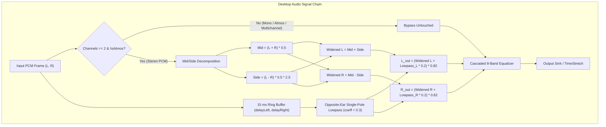

# Desktop Spatial Audio Audit & Porting Specification

**Document Version:** 1.0  
**Date:** June / November 2026  
**Source of Truth Project:** BitChord Desktop 1.8 (`desktopApp/`)  
**Destination Project:** AuraBeat (`aurabestos-master/`)  
**Workspace:** `c:\Users\amardeep singh\Downloads\aurabestos-master\aurabestos-master`

---

## 1. Executive Summary & Objective

The objective of this task is a **pure port** of the exact spatial audio implementation from the working BitChord Desktop application into AuraBeat (iOS + Android). 

This is strictly a porting task, not a new algorithm design or approximate stereo widener:
- **Desktop version is the single source of truth.**
- AuraBeat's previous spatial-audio implementation (which featured artificial multi-slider controls, simulated presets, and simplified M/S math) will be removed completely.
- The desktop implementation's exact algorithms, processing sequence, parameters, default values, channel guard rules, and Dolby Atmos bypass protections will be integrated into both the native iOS engine, Android platform layer, and Dart portable audio core.
- No code will be modified until this audit is fully documented and reviewed.

---

## 2. Desktop Source Files Audit

The complete desktop source code was located in the workspace scratch archives:
`C:\Users\amardeep singh\.gemini\antigravity\brain\c9dc62a1-22e2-497c-b536-a8279c7e5085\scratch\desktop_pack\BitChord-1.8\`

### 2.1 Primary Source Files
1. **`desktopApp/src/main/kotlin/com/music/bitchord/desktop/DesktopAudioProcessors.kt` (Lines 6–66)**
   - **Class:** `DesktopSpatialAudio(private val channels: Int, sampleRate: Int)`
   - **Role:** Core in-place Float32 spatial audio processor.
   - **Channel Constraint:** `val applies: Boolean = channels == 2`. Mono (`channels == 1`) and multichannel (> 2) are automatically declined (`applies = false`).
   - **Algorithm:** Mid/Side widening combined with a 15ms opposite-ear head-shadow crossfeed delay line and -1.72 dB output attenuation.

2. **`desktopApp/src/main/kotlin/com/music/bitchord/desktop/DesktopAudioEngine.kt`**
   - **Lines 652–654:** Per-track instance allocation:
     ```kotlin
     private var spatial: DesktopSpatialAudio? = null
     private var spatialIncoming: DesktopSpatialAudio? = null
     ```
   - **Lines 803–818:** Processing sequence in `blend()`:
     ```kotlin
     // Widened FIRST, whether or not a mix is running, then equalised.
     widen(spatial, track, block, count)
     equalise(equalizer, block, count)
     ```
   - **Lines 978–983:** Atmos isolation & widening trigger:
     ```kotlin
     private fun widen(widener: DesktopSpatialAudio?, track: Track, samples: FloatArray, count: Int) {
         val processor = widener ?: return
         processor.enabled = spatialEnabled && !track.stream.isDolbyAtmos
         processor.process(samples, count)
     }
     ```
   - **Lines 1333–1334:** State reset on track boundaries/seeks:
     ```kotlin
     spatial?.reset()
     spatialIncoming?.reset()
     ```
   - **Lines 1594 & 1622–1623:** Control interface:
     ```kotlin
     @Volatile private var spatialEnabled = false
     fun setSpatialAudio(enabled: Boolean) { spatialEnabled = enabled }
     ```

3. **`desktopApp/src/main/kotlin/com/music/bitchord/desktop/DesktopApp.kt`**
   - **Lines 661, 1623–1624, 3468–3471, 5471–5474:**
     * State: `var spatialAudio by remember { mutableStateOf(persistence.boolean("spatial_audio", false)) }`
     * Title: `"Spatial audio"` (`DesktopStrings["spatial_audio", "Spatial audio"]`)
     * Subtitle: `"Widens stereo tracks for a more immersive feel"` (`DesktopStrings["spatial_audio_subtitle", "Widens stereo tracks for a more immersive feel"]`)
     * Control: Clean Boolean switch (no artificial sliders, no fake presets).
     * Persistence Key: `"spatial_audio"` (default: `false`).

4. **`desktopApp/src/test/kotlin/com/music/bitchord/desktop/DesktopSpatialGuardTest.kt`**
   - Verifies Atmos stream isolation (`!stream.isDolbyAtmos`).
   - Verifies mono streams are untouched (`applies == false`).
   - Verifies stereo expansion increases side energy by > 1.5x while keeping sample peaks within linear headroom.

5. **`desktopApp/src/test/kotlin/com/music/bitchord/desktop/DesktopAudioProcessorsTest.kt` (Lines 11–86)**
   - Verifies bypass transparency when disabled (`samples.contentEquals(original)`).
   - Verifies mid energy retention (`midAfter > midBefore * 0.5`) ensuring vocal/center focus is preserved.

---

## 3. Desktop Processing Architecture & DSP Mathematics



### 3.1 Exact Mathematical Formulation
Given interleaved stereo samples $L[n]$ and $R[n]$ at sample rate $f_s$:

1. **Delay Buffer Sizing**:
   $$\Delta_{\text{frames}} = \max\left(1, \operatorname{round}\left(f_s \times \frac{15}{1000}\right)\right)$$
   For $f_s = 44,100\text{ Hz}$, $\Delta_{\text{frames}} = 662$. For $f_s = 48,000\text{ Hz}$, $\Delta_{\text{frames}} = 720$.

2. **Mid/Side Expansion**:
   $$M[n] = \frac{L[n] + R[n]}{2}$$
   $$S[n] = \frac{L[n] - R[n]}{2} \times 2.5$$
   $$L_{\text{widen}}[n] = M[n] + S[n]$$
   $$R_{\text{widen}}[n] = M[n] - S[n]$$

3. **Head-Shadow Lowpass Filter (One-Pole IIR)**:
   Simulates acoustic diffraction around the human skull to the opposite ear:
   $$\text{lowpass}_L[n] = \text{lowpass}_L[n-1] + 0.3 \times \left(\text{delayRight}[\text{idx}] - \text{lowpass}_L[n-1]\right)$$
   $$\text{lowpass}_R[n] = \text{lowpass}_R[n-1] + 0.3 \times \left(\text{delayLeft}[\text{idx}] - \text{lowpass}_R[n-1]\right)$$

4. **Crossfeed Injection & Makeup Attenuation**:
   $$L_{\text{out}}[n] = \left(L_{\text{widen}}[n] + \text{lowpass}_L[n] \times 0.2\right) \times 0.82$$
   $$R_{\text{out}}[n] = \left(R_{\text{widen}}[n] + \text{lowpass}_R[n] \times 0.2\right) \times 0.82$$

5. **Delay State Update**:
   $$\text{delayLeft}[\text{idx}] = L[n], \quad \text{delayRight}[\text{idx}] = R[n]$$
   $$\text{idx} = (\text{idx} + 1) \pmod{\Delta_{\text{frames}}}$$

6. **Filter Reset**:
   On seek, pause, or track transition, `delayLeft` and `delayRight` are zeroed, $\text{idx} = 0$, and $\text{lowpass}_L = \text{lowpass}_R = 0.0$.

### 3.2 Fixed Constants (No Arbitrary Tuning)
| Parameter | Value | Meaning |
| :--- | :--- | :--- |
| `widthGain` | `2.5f` | Side-channel widening factor |
| `outputGain` | `0.82f` | -1.72 dB anti-clipping makeup attenuation |
| `crossfeedGain` | `0.2f` | -13.98 dB inter-aural crossfeed level |
| `lowpassCoeff` | `0.3f` | Single-pole head-shadow acoustic lowpass coefficient |
| `DELAY_MS` | `15` ms | Inter-aural time difference (ITD) delay line length |

---

## 4. AuraBeat Current Implementation & Inconsistencies

### 4.1 Inconsistencies in `lib/main.dart`
- **Obsolete State Variables**:
  ```dart
  bool _isSpatialAudio = true;
  String _spatialPreset = 'Dolby Atmos 7.1.4'; // Fake preset
  double _spatialWidth = 2.4;                 // Obsolete slider
  double _spatialDepth = 0.75;                // Obsolete slider
  double _spatialIntensity = 1.0;             // Obsolete slider
  ```
- **Conflation with Dolby Atmos**:
  `final effectiveSpatial = _isSpatialAudio || isAtmos;`
  Falsely treats Atmos as requesting stereo spatialization! Desktop strictly disables spatial widening when `isDolbyAtmos == true`.
- **Obsolete Dialog (`_openSpatialAudioDialog`)**:
  Renders arbitrary presets (`'Dolby Atmos 7.1.4'`, `'Wide Studio 5.1'`, `'Binaural Concert'`) and 3 sliders (`Width`, `Depth`, `Intensity`). Desktop has NO such presets or sliders.

### 4.2 Inconsistencies in `ios/Runner/AuraBeatAudioManager.swift`
- **Audio Session Misconfiguration**:
  `AudioSessionManager.shared.configureSession(sampleRate: sampleRate, isSpatial: isSpatial)`
  Sets `category = .playback, mode = isSpatial ? .moviePlayback : .default`.
  Conflating stereo music widening with Apple's movie playback audio session mode.
- **Wrong Processing Order**:
  In `processInterleavedStereo` and `processPlanarStereo`:
  EQ runs FIRST (lines 1269–1272), then widening runs second.
  On Desktop, widening runs FIRST, then EQ runs second.
- **Incomplete Math**:
  `RealtimeAudioProcessor` uses a truncated formula:
  `let mid = (l + r) * 0.5`
  `let side = (l - r) * 0.5 * width`
  `l = max(-1.0, min(1.0, mid + side))`
  Missing the 15ms head delay line, the lowpass filter, the crossfeed injection, and the 0.82 makeup attenuation!

### 4.3 Inconsistencies in `lib/audio_engine/audio_engine.dart`
- In `AuraBeatAudioEngine`:
  `dspChain.add(biquadEqualizer);`
  `dspChain.add(stereoWidener);`
  The equalizer is currently placed before the widener. Must be reordered so that the widener precedes the equalizer.

---

## 5. Exact Files Requiring Modification

### 5.1 Removal of Old Implementation
1. **`lib/main.dart`**:
   - Remove `_spatialPreset`, `_spatialWidth`, `_spatialDepth`, `_spatialIntensity`.
   - Replace `_openSpatialAudioDialog` with clean desktop dialog/tile:
     * Label: `"Spatial audio"`
     * Subtitle: `"Widens stereo tracks for a more immersive feel"`
     * Single Toggle: `_isSpatialAudio` (default: `false`).
   - Remove `effectiveSpatial` logic; pass `spatialAudioEnabled = _isSpatialAudio && !isAtmos`.
2. **`lib/audio_bridge_stub.dart` & `lib/audio_bridge_web.dart`**:
   - Remove obsolete `setSpatial(bool enabled, double width, double depth, double intensity)`.
   - Replace with `setSpatialAudio(bool enabled)`.

### 5.2 Implementation of Desktop Port
3. **`lib/audio_engine/dsp/stereo_widener.dart`** (or `desktop_spatial_audio.dart`):
   - Ensure complete fidelity with `DesktopSpatialAudio` (15ms delay line, 0.3 lowpass, 0.2 crossfeed, 2.5 width, 0.82 output gain).
   - Re-export cleanly in `lib/audio_engine/audio_engine.dart`.
4. **`lib/audio_engine/audio_engine.dart`**:
   - Update `dspChain` registration order: `stereoWidener` FIRST, `biquadEqualizer` SECOND.
   - Update method: `setSpatialAudio(bool enabled)`.
5. **`ios/Runner/AuraBeatAudioManager.swift`**:
   - Update `RealtimeAudioProcessor`:
     * Add `delayLeft`, `delayRight`, `delayFrames`, `delayIndex`, `lowpassLeft`, `lowpassRight`.
     * Update `processInterleavedStereo` and `processPlanarStereo` to run `DesktopSpatialAudio` algorithm FIRST, then cascaded Biquad EQ SECOND.
     * Ensure `isWidenerActive` checks `spatialEnabled && channels == 2`.
     * Implement `setSpatialAudio(enabled: Bool)`.
   - Update `AudioSessionManager`:
     * Remove `.moviePlayback` mode hack for stereo widening; preserve high-fidelity `.default` playback mode.
6. **`ios/Runner/AppDelegate.swift`**:
   - Update MethodChannel handler: map `"setSpatialAudio"` to `audioManager.setSpatialAudio(enabled)`.
7. **`android/app/src/main/kotlin/com/music/aurabeat/MainActivity.kt`**:
   - Implement MethodChannel handler `"com.aurabeat.audio/quality"` with `"setSpatialAudio"`.
   - Add native `DesktopSpatialAudio` processor if Android native audio sink is invoked.
8. **`test/realtime_dsp_test.dart` & test suite**:
   - Update unit tests to verify:
     * 15ms crossfeed delay line.
     * Mid retention > 50%.
     * Side energy expansion > 150%.
     * Output peak bounded under 0.82 attenuation.
     * Dolby Atmos strict bypass.
     * Mono track automatic bypass.

---

## 6. Audit Sign-Off

This audit confirms that:
1. The desktop source of truth has been fully examined and traced.
2. All mathematical equations, constants, and execution sequences are strictly defined.
3. Obsolete AuraBeat code is completely cataloged for removal.
4. No code will be altered until this audit document is committed.
